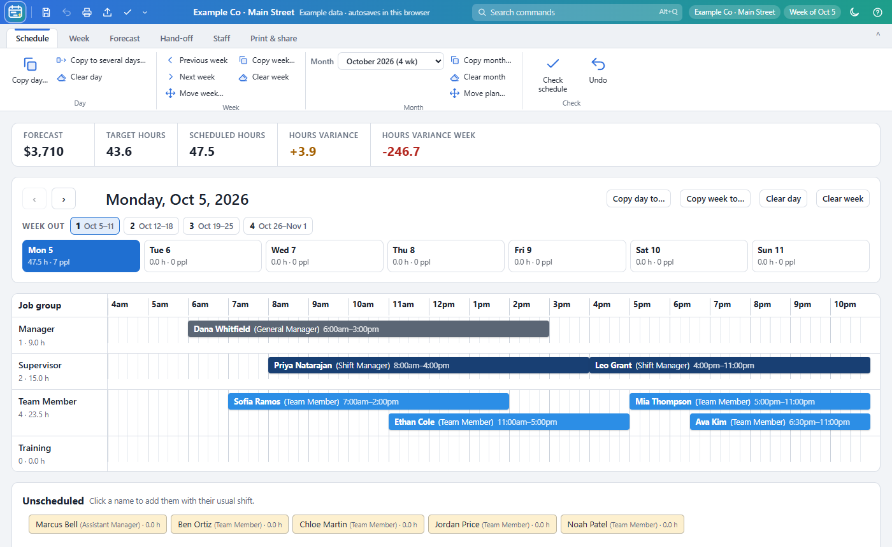
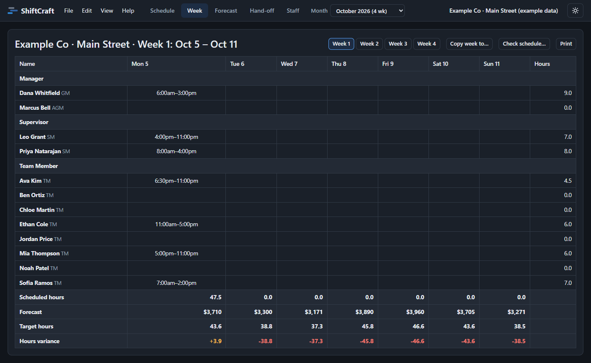

# ShiftCraft

**Employee scheduler and planner for day, week and month labor planning.**

ShiftCraft is a planning board for building a work schedule *before* you type it into the real scheduling system (which is often locked or slow). Lay out the day on a timeline, check coverage and labor hours against the sales forecast, then hand the finished schedule off, print it, or email it.

It is one HTML file. No install, no account, no server: open `index.html` in Chrome or Edge and everything stays on your computer.

## Getting started

1. Download this repository (green **Code** button › **Download ZIP**) or clone it.
2. Double-click `index.html`. It opens in your browser.
3. It starts with **made-up example staff and sales** so you can try everything. When you are ready: **Staff** tab › **Clear list**, add your own team, then **File › Save team only**.
4. Set your company and location with **File › Company & location** (or click the store name at the top right).

> Example names in this repository are invented. Your own team, schedules and settings are saved in your browser and in the files you choose to save; nothing is uploaded anywhere.

## Finding your way

| Where | What is there |
| --- | --- |
| **ShiftCraft logo** (top left) | Every command in classic menus: File, Edit, View, Help (also F10) |
| **Top bar** | Quick buttons (save week, undo, print, email/share, check schedule; customize them with ⌄), the plan name, **Search commands (Alt+Q)**, company and week, theme, help |
| **Ribbon tabs** | **Schedule, Week, Forecast, Hand-off, Staff, Company & Location:** each switches to that view and shows its tools. **Print & share:** pictures, printing, email and saving |
| **Schedule tab** | Copy or clear a day, week or month, the month picker, move weeks, check the schedule, undo |

## What it does

### Plan the day
- **Timeline from 4:00am to 11:00pm** in 15-minute steps, grouped into **Manager** (GM, AGM), **Supervisor** (Shift Manager), **Team Member** and **Training** (New Hire).
- **Click a name** under *Unscheduled* to add that person with their usual shift.
- **Drag** a shift to move it; **drag its left or right edge** to change the start or finish.
- **Double-click** a shift to type exact times (am/pm). Times always read like `6:00am – 2:30pm`.
- **Click** a shift for that person's **notes for the day**. Notes appear under the bar in yellow highlighter (`NOTES: …`) and on every printout.
- **Right-click** a shift: edit, add a note, tasks and training, or remove.
- **Ctrl+Z** undoes.

### Weeks and months
- Weeks run **Monday to Sunday**.
- Pick a **month** at the top. A month is the weeks whose Monday falls in it, so it is always **4 or 5 weeks**. **Week out 1–5** jumps between them.
- Every day is stored by date, so you can move between months and come back.
- **Copy** a day, week or month to new dates (from any dates, past ones too). **Clear** a day, week or month. Move weeks around.

### Labor and forecast
- **Forecast**: by default, the average of the same weekday over the last 4 weeks of past sales. Type your own number to override it.
- **Target hours** = forecast ÷ sales per labor hour (set in Settings).
- **Hours variance**: scheduled hours minus target, for the day and the week.
- **Hours by section**: each person's hours today, week so far and week total, with day and week totals for every group.

### Staff
The Staff tab has four sections:
- **1 · Weekdays** (Monday to Friday): usual weekday shift, the **hours they can work** (any time, or from–until), **AM / MID / PM**, the weekdays they are **not available**, max hours per week, and active or not.
- **2 · Weekend** (Saturday and Sunday), kept apart because many people can work any time at the weekend but not on weekdays: their own **usual weekend shift**, hours they can work, AM / MID / PM, and Saturday or Sunday off. Clicking a name under Unscheduled uses the weekday or weekend usual shift to suit the day.
- **3 · Contact & training:** **email** (✉ writes one), **phone number** (☎ calls) and notes, and **Trained in**: a grid with everyone down the side and the location's positions across the top (names written upwards). Click a box for **Yes** (trained) or **No**; click a position's name to mark everyone, or a person's count to mark every position for them. Totals show how many people are trained in each position.
- **4 · Day by day:** each day of the week on its own, as on the printed availability list. Click a day for **Any**, **Off**, **Hours** or **A note** (Mornings, Afternoons, Evenings, Emergency, If you ask, or your own words). Hours are ranges: **+ Can work** and **+ Can't work** (e.g. *Open – Close, not 12pm – 1pm*); where they overlap, can't wins. **Highlight** marks a day orange. **From usual** fills the week from the weekday and weekend settings, then you change the odd day. Also **Validated** (availability checked with them) and **Pending training**.
- **Print or save** (the printer button in the title bar) now also has **Layout › Availability and contact list**, next to the week table, timeline and calendar, with a **print preview** of the page as it will print, a choice of **paper** (Letter 8.5 × 11, Legal 8.5 × 14 or Tabloid 11 × 17, landscape; bigger paper, bigger print, still one page), and **Save** as **PDF, PNG, JPG or BMP** at the resolution you choose (150 to 1200 DPI), or Print straight to the printer.
- **Opening an older team file** (saved before positions were carried in the file): if its “trained in” ticks do not match this location's positions, ShiftCraft asks which position each one is, filled in with a guess in the location's order and showing how many are trained in each.
- **Print & share › Availability list** prints the *Schedule Availability and Contact Information* sheet (landscape): Managers, Supervisors and Team Members with phone numbers, positions trained in, Monday to Sunday (green = hours, black = off, orange = highlighted) and Validated; people pending training are listed last in yellow. It carries a version stamp (year.month.day.hour.minute, 24-hour). Phone numbers have to be listed: the Day by day tab has a phone box (red when empty), and printing first names anyone without a number.
- Name and role on every section. Shifts outside someone's availability for that day (days off, hours, AM / MID / PM) are flagged on the schedule and in Check schedule.
- **Left…** on a person's row: resigned, terminated or other, with their last day and a note. They come off the schedule, the lists and the printouts (and, if you like, off their shifts after the last day), and everything about them is kept under **Former staff** at the bottom of the Staff tab: phone, email, availability, training, tasks and past shifts. **Rehire** brings them back as they were; Delete removes them for good.
- **Tasks and training** per person with dates, plus an editable **new-hire checklist**.
- Save, load or clear the team list.

### Company & Location
- The **company and location details** used on every plan, printout and file name: company, location, store number, address, phone, **email** and **website**, edited right on the page (they save as you go). Click the store name in the top bar to get here.
- **Opening hours** for weekdays and for the weekend, and **notes** about the location.
- **Positions** at the location, starting with the standard list (Open, Close, Hot Prep, Cold Prep, Juices & Smoothies, Dish, Greeting, Salad Line, Sandwich Line, Bowls & Wrapping, Cashier & Register, Online, Dining Room, Catering): rename, reorder, untick **In use** for ones this location doesn't have, add your own, or go back to the standard list. Saved with the location.
### Check the schedule
**Edit › Check schedule** finds people booked twice, shifts outside availability, inactive people on the schedule, shifts over 10 hours, people over their weekly max, and times with **no Manager or Shift Manager on the floor**.

### Print, pictures and hand-off
- **Hand-off** tab: the day's shifts in order, ready to copy into the real scheduler.
- **Print schedules** for one person or a whole group.
- **Week table**, **visual timeline** (bars plus a *people on the floor* chart) and **calendar** (week, 2 weeks, month or whole plan).
- **Print screen** (Ctrl+Shift+P): a picture of exactly what is on screen, including parts you would scroll to.
- Save pictures as **PNG, JPG, BMP or SVG** at **150 to 4800 DPI** (300 DPI default). Very high DPI saves as SVG, which prints sharp at any size.
- **Printouts and pictures always use light colors**, even when you edit in dark mode.
- Text and CSV export.

### Files and sharing
- **File › Save…** asks *what* to save:
  - **Everything**: team plus all weeks, months, forecasts, past sales and settings (a *location* file)
  - **Team only**
  - **Schedule only**: a day, week, month, or a range of weeks
- File names look like `Company - Location - 11-02-2026 - 12-06-2026.json`.
- **File › Open** recognises the kind of file, checks it, and fixes small problems (times out of range, missing ids, unknown roles), telling you what it fixed. Weeks match people by name, so a schedule can be opened on another computer with a different team list.
- **File › Save emailable file (.html)**: one file containing ShiftCraft *and* the schedule. Attach it to an email; the person double-clicks it and it opens, no install needed.
- **File › Email or share…** uses Windows sharing (Mail, Outlook…) when available, or saves the files and starts an email.

### Other
- **Light and dark mode** (sun/moon button). Dark mode is for editing only.
- Autosaves in the browser; **Settings** shows how much storage is used and can clear old weeks.
- If something goes wrong at start-up, a banner offers a backup of your data.

## Keyboard shortcuts

| Action | Keys |
| --- | --- |
| Save everything (team, availability, schedules, settings) | Ctrl+S |
| Save… (choose what) | Ctrl+Shift+S |
| Open | Ctrl+O |
| Print | Ctrl+P |
| Print screen | Ctrl+Shift+P |
| Undo | Ctrl+Z |
| Previous / next day | ← / → |

## Requirements

Chrome or Edge on Windows, macOS or Linux (recent versions). Firefox and Safari work too, but cannot save straight into a folder; they download files instead.

## Files in this repository

| File | What it is |
| --- | --- |
| `index.html` | The whole app (HTML, CSS and JavaScript in one file, no libraries) |
| `README.txt` | The same help in plain text, for people who download only the app |
| `docs/` | Screenshots for this page |
| `plans/`, `staff-lists/` | Suggested folders for your saved files (their contents are never uploaded to GitHub) |

## How this was made

This app is **vibe coded**: its author designed and directed it in plain conversation, feature by feature, and an AI coding assistant (Claude, by Anthropic) wrote the code.

It is a **genuine clean-room build**, not a decompiled or AI-rebuilt copy of anything:
- Nothing was decompiled, disassembled or reverse-engineered, in whole or in part.
- No code, artwork, fonts, icons or data files from any original program were used, and none were given to the AI to work from.
- ShiftCraft takes ideas from everyday spreadsheet and scheduling tools; only publicly known features and general ideas guided the design. Every line of code and every picture here was made new.

It uses no outside code libraries: everything is in one file.

## Development notes

How the app is built, the decisions behind it, and known pitfalls: see [NOTES.md](NOTES.md).
